# Poly Haven: Mountains & Hills HDRIs

**108 assets from [Poly Haven](https://polyhaven.com), dedicated to the public domain under [CC0](https://polyhaven.com/license).** Use them in any game, free or paid, and change them however you like; no credit is needed.

HDRI skies and environments as 1K and 2K Radiance `.hdr` images, for lighting and backgrounds. 855.2 MB in all.

This is a copy kept by [zuujis-cc0](https://github.com/zuujis-cc0) so game makers can take single files from GitHub. It is not made by or affiliated with Poly Haven: the originals, often in more formats and higher resolutions, are on [polyhaven.com](https://polyhaven.com). If they help you, consider [supporting Poly Haven](https://www.patreon.com/polyhaven/overview).

Every file is listed in [MANIFEST.tsv](MANIFEST.tsv) with its size and SHA-256. More free assets: [the Zuujis collection](https://github.com/zuujis-cc0/free-game-assets#readme).

| | | | |
| :-: | :-: | :-: | :-: |
| <a href="alps_field">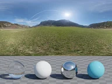</a> <b><a href="alps_field">Alps Field</a></b> by Andreas Mischok · <a href="https://polyhaven.com/a/alps_field">source</a> | <a href="autumn_hill_view">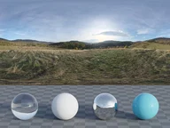</a> <b><a href="autumn_hill_view">Autumn Hill View</a></b> by Grzegorz Wronkowski · <a href="https://polyhaven.com/a/autumn_hill_view">source</a> | <a href="aviation_museum_hill">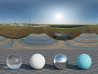</a> <b><a href="aviation_museum_hill">Aviation Museum Hill</a></b> by Sergej Majboroda · <a href="https://polyhaven.com/a/aviation_museum_hill">source</a> | <a href="belfast_sunset">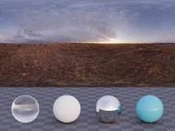</a> <b><a href="belfast_sunset">Belfast Sunset</a></b> by Dimitrios Savva, Greg Zaal · <a href="https://polyhaven.com/a/belfast_sunset">source</a> |
| <a href="bell_park_dawn">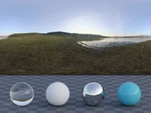</a> <b><a href="bell_park_dawn">Bell Park Dawn</a></b> by Greg Zaal · <a href="https://polyhaven.com/a/bell_park_dawn">source</a> | <a href="bergen">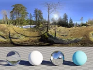</a> <b><a href="bergen">Bergen</a></b> by Greg Zaal · <a href="https://polyhaven.com/a/bergen">source</a> | <a href="blaubeuren_hillside">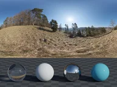</a> <b><a href="blaubeuren_hillside">Blaubeuren Hillside</a></b> by Andreas Mischok · <a href="https://polyhaven.com/a/blaubeuren_hillside">source</a> | <a href="bloem_hill_01">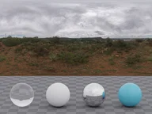</a> <b><a href="bloem_hill_01">Bloem Hill 01</a></b> by Greg Zaal, Jenelle van Heerden · <a href="https://polyhaven.com/a/bloem_hill_01">source</a> |
| <a href="bloem_hill_02">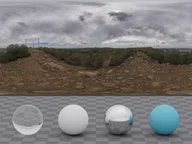</a> <b><a href="bloem_hill_02">Bloem Hill 02</a></b> by Greg Zaal, Jenelle van Heerden · <a href="https://polyhaven.com/a/bloem_hill_02">source</a> | <a href="bloem_hill_03">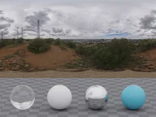</a> <b><a href="bloem_hill_03">Bloem Hill 03</a></b> by Greg Zaal, Jenelle van Heerden · <a href="https://polyhaven.com/a/bloem_hill_03">source</a> | <a href="cayley_lookout">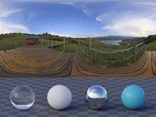</a> <b><a href="cayley_lookout">Cayley Lookout</a></b> by Greg Zaal · <a href="https://polyhaven.com/a/cayley_lookout">source</a> | <a href="champagne_castle_1">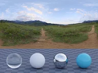</a> <b><a href="champagne_castle_1">Champagne Castle 1</a></b> by Greg Zaal · <a href="https://polyhaven.com/a/champagne_castle_1">source</a> |
| <a href="clarens_midday">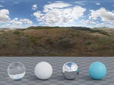</a> <b><a href="clarens_midday">Clarens Midday</a></b> by Dimitrios Savva, Jarod Guest · <a href="https://polyhaven.com/a/clarens_midday">source</a> | <a href="clarens_night_01">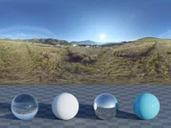</a> <b><a href="clarens_night_01">Clarens Night 01</a></b> by Dimitrios Savva, Jarod Guest · <a href="https://polyhaven.com/a/clarens_night_01">source</a> | <a href="clarens_night_02">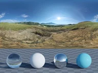</a> <b><a href="clarens_night_02">Clarens Night 02</a></b> by Dimitrios Savva, Jarod Guest · <a href="https://polyhaven.com/a/clarens_night_02">source</a> | <a href="cliffside">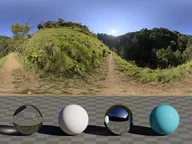</a> <b><a href="cliffside">Cliffside</a></b> by Greg Zaal · <a href="https://polyhaven.com/a/cliffside">source</a> |
| <a href="dalkey_view">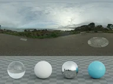</a> <b><a href="dalkey_view">Dalkey View</a></b> by Savva Zakharov · <a href="https://polyhaven.com/a/dalkey_view">source</a> | <a href="drackenstein_quarry">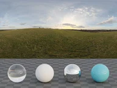</a> <b><a href="drackenstein_quarry">Drackenstein Quarry</a></b> by Andreas Mischok · <a href="https://polyhaven.com/a/drackenstein_quarry">source</a> | <a href="drakensberg_solitary_mountain">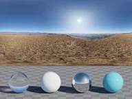</a> <b><a href="drakensberg_solitary_mountain">Drakensberg Solitary Mountain</a></b> by Dimitrios Savva, Jarod Guest · <a href="https://polyhaven.com/a/drakensberg_solitary_mountain">source</a> | <a href="ehingen_hillside">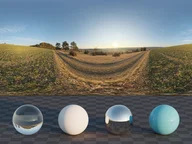</a> <b><a href="ehingen_hillside">Ehingen Hillside</a></b> by Andreas Mischok · <a href="https://polyhaven.com/a/ehingen_hillside">source</a> |
| <a href="ehingen_hillside_02">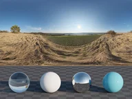</a> <b><a href="ehingen_hillside_02">Ehingen Hillside 02</a></b> by Andreas Mischok · <a href="https://polyhaven.com/a/ehingen_hillside_02">source</a> | <a href="fish_eagle_hill">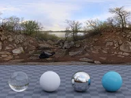</a> <b><a href="fish_eagle_hill">Fish Eagle Hill</a></b> by Greg Zaal · <a href="https://polyhaven.com/a/fish_eagle_hill">source</a> | <a href="flamingo_pan">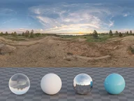</a> <b><a href="flamingo_pan">Flamingo Pan</a></b> by Dimitrios Savva, Jarod Guest · <a href="https://polyhaven.com/a/flamingo_pan">source</a> | <a href="flower_hillside">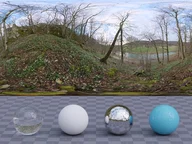</a> <b><a href="flower_hillside">Flower Hillside</a></b> by Andreas Mischok · <a href="https://polyhaven.com/a/flower_hillside">source</a> |
| <a href="fort_schanskop_morning">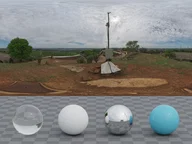</a> <b><a href="fort_schanskop_morning">Fort Schanskop Morning</a></b> by Dimitrios Savva, Jarod Guest · <a href="https://polyhaven.com/a/fort_schanskop_morning">source</a> | <a href="fouriesburg_mountain_cloudy">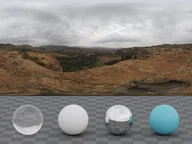</a> <b><a href="fouriesburg_mountain_cloudy">Fouriesburg Mountain Cloudy</a></b> by Dimitrios Savva, Jarod Guest · <a href="https://polyhaven.com/a/fouriesburg_mountain_cloudy">source</a> | <a href="fouriesburg_mountain_lookout">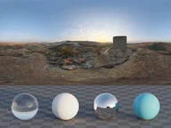</a> <b><a href="fouriesburg_mountain_lookout">Fouriesburg Mountain Lookout</a></b> by Dimitrios Savva, Jarod Guest · <a href="https://polyhaven.com/a/fouriesburg_mountain_lookout">source</a> | <a href="fouriesburg_mountain_lookout_2">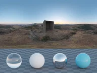</a> <b><a href="fouriesburg_mountain_lookout_2">Fouriesburg Mountain Lookout 2</a></b> by Dimitrios Savva, Jarod Guest · <a href="https://polyhaven.com/a/fouriesburg_mountain_lookout_2">source</a> |
| <a href="fouriesburg_mountain_midday">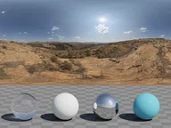</a> <b><a href="fouriesburg_mountain_midday">Fouriesburg Mountain Midday</a></b> by Dimitrios Savva, Jarod Guest · <a href="https://polyhaven.com/a/fouriesburg_mountain_midday">source</a> | <a href="gamrig">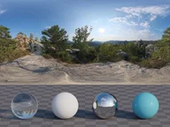</a> <b><a href="gamrig">Gamrig</a></b> by Andreas Mischok · <a href="https://polyhaven.com/a/gamrig">source</a> | <a href="glasshouse_sunset">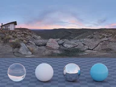</a> <b><a href="glasshouse_sunset">Glasshouse Sunset</a></b> by Greg Zaal, Jarod Guest · <a href="https://polyhaven.com/a/glasshouse_sunset">source</a> | <a href="golden_gate_hills">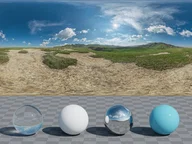</a> <b><a href="golden_gate_hills">Golden Gate Hills</a></b> by Dimitrios Savva, Jarod Guest · <a href="https://polyhaven.com/a/golden_gate_hills">source</a> |
| <a href="harties">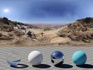</a> <b><a href="harties">Harties</a></b> by Greg Zaal · <a href="https://polyhaven.com/a/harties">source</a> | <a href="harties_cliff_view">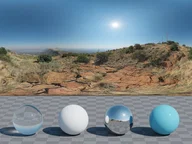</a> <b><a href="harties_cliff_view">Harties Cliff View</a></b> by Dimitrios Savva, Jarod Guest · <a href="https://polyhaven.com/a/harties_cliff_view">source</a> | <a href="hilltop_construction">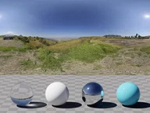</a> <b><a href="hilltop_construction">Hilltop Construction</a></b> by Greg Zaal · <a href="https://polyhaven.com/a/hilltop_construction">source</a> | <a href="hilly_terrain_01">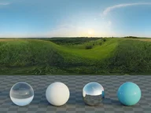</a> <b><a href="hilly_terrain_01">Hilly Terrain 01</a></b> by Sergej Majboroda · <a href="https://polyhaven.com/a/hilly_terrain_01">source</a> |
| <a href="immenstadter_horn">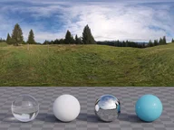</a> <b><a href="immenstadter_horn">Immenstädter Horn</a></b> by Andreas Mischok · <a href="https://polyhaven.com/a/immenstadter_horn">source</a> | <a href="kiara_1_dawn">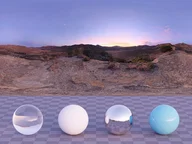</a> <b><a href="kiara_1_dawn">Kiara 1 Dawn</a></b> by Greg Zaal · <a href="https://polyhaven.com/a/kiara_1_dawn">source</a> | <a href="kiara_2_sunrise">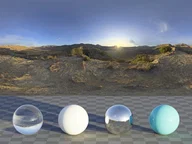</a> <b><a href="kiara_2_sunrise">Kiara 2 Sunrise</a></b> by Greg Zaal · <a href="https://polyhaven.com/a/kiara_2_sunrise">source</a> | <a href="kiara_3_morning">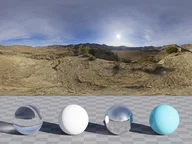</a> <b><a href="kiara_3_morning">Kiara 3 Morning</a></b> by Greg Zaal · <a href="https://polyhaven.com/a/kiara_3_morning">source</a> |
| <a href="kiara_4_mid-morning">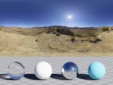</a> <b><a href="kiara_4_mid-morning">Kiara 4 Mid-Morning</a></b> by Greg Zaal · <a href="https://polyhaven.com/a/kiara_4_mid-morning">source</a> | <a href="kiara_5_noon">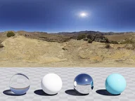</a> <b><a href="kiara_5_noon">Kiara 5 Noon</a></b> by Greg Zaal · <a href="https://polyhaven.com/a/kiara_5_noon">source</a> | <a href="kiara_6_afternoon">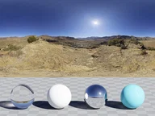</a> <b><a href="kiara_6_afternoon">Kiara 6 Afternoon</a></b> by Greg Zaal · <a href="https://polyhaven.com/a/kiara_6_afternoon">source</a> | <a href="kiara_7_late-afternoon">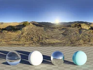</a> <b><a href="kiara_7_late-afternoon">Kiara 7 Late-Afternoon</a></b> by Greg Zaal · <a href="https://polyhaven.com/a/kiara_7_late-afternoon">source</a> |
| <a href="kiara_8_sunset">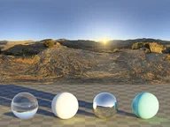</a> <b><a href="kiara_8_sunset">Kiara 8 Sunset</a></b> by Greg Zaal · <a href="https://polyhaven.com/a/kiara_8_sunset">source</a> | <a href="kiara_9_dusk">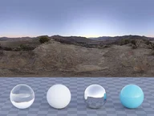</a> <b><a href="kiara_9_dusk">Kiara 9 Dusk</a></b> by Greg Zaal · <a href="https://polyhaven.com/a/kiara_9_dusk">source</a> | <a href="klippad_dawn_1">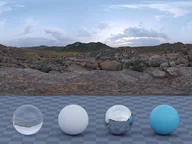</a> <b><a href="klippad_dawn_1">Klippad Dawn 1</a></b> by Greg Zaal · <a href="https://polyhaven.com/a/klippad_dawn_1">source</a> | <a href="klippad_dawn_2">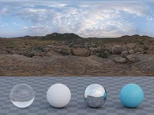</a> <b><a href="klippad_dawn_2">Klippad Dawn 2</a></b> by Greg Zaal · <a href="https://polyhaven.com/a/klippad_dawn_2">source</a> |
| <a href="klippad_sunrise_1">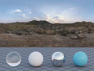</a> <b><a href="klippad_sunrise_1">Klippad Sunrise 1</a></b> by Greg Zaal · <a href="https://polyhaven.com/a/klippad_sunrise_1">source</a> | <a href="klippad_sunrise_2">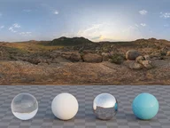</a> <b><a href="klippad_sunrise_2">Klippad Sunrise 2</a></b> by Greg Zaal · <a href="https://polyhaven.com/a/klippad_sunrise_2">source</a> |  <b><a href="kloetzle_blei">Kloetzle Blei</a></b> by Andreas Mischok · <a href="https://polyhaven.com/a/kloetzle_blei">source</a> |  <b><a href="kloofendal_28d_misty">Kloofendal 28d Misty</a></b> by Greg Zaal, Jenelle van Heerden · <a href="https://polyhaven.com/a/kloofendal_28d_misty">source</a> |
|  <b><a href="kloofendal_38d_partly_cloudy">Kloofendal 38d Partly Cloudy</a></b> by Greg Zaal · <a href="https://polyhaven.com/a/kloofendal_38d_partly_cloudy">source</a> |  <b><a href="kloofendal_43d_clear">Kloofendal 43d Clear</a></b> by Greg Zaal · <a href="https://polyhaven.com/a/kloofendal_43d_clear">source</a> |  <b><a href="kloofendal_48d_partly_cloudy">Kloofendal 48d Partly Cloudy</a></b> by Greg Zaal · <a href="https://polyhaven.com/a/kloofendal_48d_partly_cloudy">source</a> |  <b><a href="kloofendal_misty_morning">Kloofendal Misty Morning</a></b> by Greg Zaal · <a href="https://polyhaven.com/a/kloofendal_misty_morning">source</a> |
|  <b><a href="kloofendal_overcast">Kloofendal Overcast</a></b> by Greg Zaal · <a href="https://polyhaven.com/a/kloofendal_overcast">source</a> |  <b><a href="kloppenheim_06">Kloppenheim 06</a></b> by Greg Zaal · <a href="https://polyhaven.com/a/kloppenheim_06">source</a> |  <b><a href="lago_disola">Lago d'Isola</a></b> by Andreas Mischok · <a href="https://polyhaven.com/a/lago_disola">source</a> |  <b><a href="lenong_1">Lenong 1</a></b> by Greg Zaal · <a href="https://polyhaven.com/a/lenong_1">source</a> |
|  <b><a href="lenong_2">Lenong 2</a></b> by Greg Zaal · <a href="https://polyhaven.com/a/lenong_2">source</a> |  <b><a href="lenong_3">Lenong 3</a></b> by Greg Zaal · <a href="https://polyhaven.com/a/lenong_3">source</a> |  <b><a href="monte_scherbelino">Monte Scherbelino</a></b> by Andreas Mischok · <a href="https://polyhaven.com/a/monte_scherbelino">source</a> |  <b><a href="montorfano">Montorfano</a></b> by Andreas Mischok · <a href="https://polyhaven.com/a/montorfano">source</a> |
|  <b><a href="neurathen_rock_castle">Neurathen Rock Castle</a></b> by Andreas Mischok · <a href="https://polyhaven.com/a/neurathen_rock_castle">source</a> |  <b><a href="northcliff">Northcliff</a></b> by Greg Zaal · <a href="https://polyhaven.com/a/northcliff">source</a> |  <b><a href="orbita">Orbita</a></b> by Alex Radosnov · <a href="https://polyhaven.com/a/orbita">source</a> |  <b><a href="pizzo_pernice">Pizzo Pernice</a></b> by Andreas Mischok · <a href="https://polyhaven.com/a/pizzo_pernice">source</a> |
|  <b><a href="qwantani">Qwantani</a></b> by Greg Zaal · <a href="https://polyhaven.com/a/qwantani">source</a> |  <b><a href="qwantani_afternoon">Qwantani Afternoon</a></b> by Greg Zaal, Jarod Guest · <a href="https://polyhaven.com/a/qwantani_afternoon">source</a> |  <b><a href="qwantani_dawn">Qwantani Dawn</a></b> by Greg Zaal, Jarod Guest · <a href="https://polyhaven.com/a/qwantani_dawn">source</a> |  <b><a href="qwantani_dusk_1">Qwantani Dusk 1</a></b> by Greg Zaal, Jarod Guest · <a href="https://polyhaven.com/a/qwantani_dusk_1">source</a> |
|  <b><a href="qwantani_dusk_2">Qwantani Dusk 2</a></b> by Greg Zaal, Jarod Guest · <a href="https://polyhaven.com/a/qwantani_dusk_2">source</a> |  <b><a href="qwantani_late_afternoon">Qwantani Late Afternoon</a></b> by Greg Zaal, Jarod Guest · <a href="https://polyhaven.com/a/qwantani_late_afternoon">source</a> |  <b><a href="qwantani_mid_morning">Qwantani Mid Morning</a></b> by Greg Zaal, Jarod Guest · <a href="https://polyhaven.com/a/qwantani_mid_morning">source</a> |  <b><a href="qwantani_moon_noon">Qwantani Moon Noon</a></b> by Greg Zaal, Jarod Guest · <a href="https://polyhaven.com/a/qwantani_moon_noon">source</a> |
|  <b><a href="qwantani_moonrise">Qwantani Moonrise</a></b> by Greg Zaal, Jarod Guest · <a href="https://polyhaven.com/a/qwantani_moonrise">source</a> |  <b><a href="qwantani_morning">Qwantani Morning</a></b> by Jarod Guest · <a href="https://polyhaven.com/a/qwantani_morning">source</a> |  <b><a href="qwantani_night">Qwantani Night</a></b> by Greg Zaal, Jarod Guest · <a href="https://polyhaven.com/a/qwantani_night">source</a> |  <b><a href="qwantani_noon">Qwantani Noon</a></b> by Greg Zaal, Jarod Guest · <a href="https://polyhaven.com/a/qwantani_noon">source</a> |
|  <b><a href="qwantani_sunrise">Qwantani Sunrise</a></b> by Greg Zaal, Jarod Guest · <a href="https://polyhaven.com/a/qwantani_sunrise">source</a> |  <b><a href="qwantani_sunset">Qwantani Sunset</a></b> by Greg Zaal, Jarod Guest · <a href="https://polyhaven.com/a/qwantani_sunset">source</a> |  <b><a href="rhodes_memorial">Rhodes Memorial</a></b> by Greg Zaal, Rico Cilliers · <a href="https://polyhaven.com/a/rhodes_memorial">source</a> |  <b><a href="rocky_ridge">Rocky Ridge</a></b> by Greg Zaal · <a href="https://polyhaven.com/a/rocky_ridge">source</a> |
|  <b><a href="rolling_hills">Rolling Hills</a></b> by Dimitrios Savva, Jarod Guest · <a href="https://polyhaven.com/a/rolling_hills">source</a> |  <b><a href="rosendal_mountain_midmorning">Rosendal Mountain Midmorning</a></b> by Dimitrios Savva, Jarod Guest · <a href="https://polyhaven.com/a/rosendal_mountain_midmorning">source</a> |  <b><a href="ruckenkreuz">Ruckenkreuz</a></b> by Andreas Mischok · <a href="https://polyhaven.com/a/ruckenkreuz">source</a> |  <b><a href="rustig_koppie">Rustig Koppie</a></b> by Greg Zaal · <a href="https://polyhaven.com/a/rustig_koppie">source</a> |
|  <b><a href="signal_hill_dawn">Signal Hill Dawn</a></b> by Greg Zaal, Rico Cilliers · <a href="https://polyhaven.com/a/signal_hill_dawn">source</a> |  <b><a href="signal_hill_sunrise">Signal Hill Sunrise</a></b> by Greg Zaal, Rico Cilliers · <a href="https://polyhaven.com/a/signal_hill_sunrise">source</a> |  <b><a href="snowy_hillside">Snowy Hillside</a></b> by Andreas Mischok · <a href="https://polyhaven.com/a/snowy_hillside">source</a> |  <b><a href="snowy_hillside_02">Snowy Hillside 02</a></b> by Andreas Mischok · <a href="https://polyhaven.com/a/snowy_hillside_02">source</a> |
|  <b><a href="spaichingen_hill">Spaichingen Hill</a></b> by Andreas Mischok · <a href="https://polyhaven.com/a/spaichingen_hill">source</a> |  <b><a href="sterkspruit_falls">Sterkspruit Falls</a></b> by Greg Zaal · <a href="https://polyhaven.com/a/sterkspruit_falls">source</a> |  <b><a href="stuttgart_hillside">Stuttgart Hillside</a></b> by Andreas Mischok · <a href="https://polyhaven.com/a/stuttgart_hillside">source</a> |  <b><a href="syferfontein_0d_clear">Syferfontein 0d Clear</a></b> by Greg Zaal · <a href="https://polyhaven.com/a/syferfontein_0d_clear">source</a> |
|  <b><a href="syferfontein_18d_clear">Syferfontein 18d Clear</a></b> by Greg Zaal · <a href="https://polyhaven.com/a/syferfontein_18d_clear">source</a> |  <b><a href="syferfontein_1d_clear">Syferfontein 1d Clear</a></b> by Greg Zaal · <a href="https://polyhaven.com/a/syferfontein_1d_clear">source</a> |  <b><a href="syferfontein_6d_clear">Syferfontein 6d Clear</a></b> by Greg Zaal · <a href="https://polyhaven.com/a/syferfontein_6d_clear">source</a> |  <b><a href="table_mountain_1">Table Mountain 1</a></b> by Greg Zaal, Rico Cilliers · <a href="https://polyhaven.com/a/table_mountain_1">source</a> |
|  <b><a href="table_mountain_2">Table Mountain 2</a></b> by Greg Zaal, Rico Cilliers · <a href="https://polyhaven.com/a/table_mountain_2">source</a> |  <b><a href="ticknock_01">Ticknock 01</a></b> by Savva Zakharov · <a href="https://polyhaven.com/a/ticknock_01">source</a> |  <b><a href="ticknock_02">Ticknock 02</a></b> by Savva Zakharov · <a href="https://polyhaven.com/a/ticknock_02">source</a> |  <b><a href="ticknock_03">Ticknock 03</a></b> by Savva Zakharov · <a href="https://polyhaven.com/a/ticknock_03">source</a> |
|  <b><a href="ticknock_04">Ticknock 04</a></b> by Savva Zakharov · <a href="https://polyhaven.com/a/ticknock_04">source</a> |  <b><a href="toposcope_sunset">Toposcope Sunset</a></b> by Dario Barresi · <a href="https://polyhaven.com/a/toposcope_sunset">source</a> |  <b><a href="versveldpas">Versveldpas</a></b> by Greg Zaal · <a href="https://polyhaven.com/a/versveldpas">source</a> |  <b><a href="waterbuck_trail">Waterbuck Trail</a></b> by Greg Zaal · <a href="https://polyhaven.com/a/waterbuck_trail">source</a> |

---

Kept up to date by this repository's own [update workflow](.github/workflows/update.yml), with code and plan from [cc0-mirror](https://github.com/zuujis-cc0/cc0-mirror). Something wrong? [Open an issue there](https://github.com/zuujis-cc0/cc0-mirror/issues/new) or use the [private report form](https://games.zuujis.com/report).
